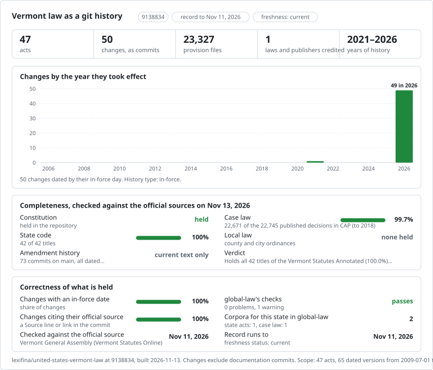

# Vermont: law history in git

<picture>
<source media="(prefers-color-scheme: dark)" srcset="data/effort-dark.svg">

</picture>

Part of [lexifina/global-law](https://github.com/lexifina/global-law), one git history for every country's law: this is the law of Vermont, United States, which global-law reads at `united-states/vermont/acts/`.

The Constitution of Vermont and the Vermont Statutes Annotated as a git repository: one file per provision, one paragraph per line, so `git blame` works line by line. It follows the shared design of [lexifina/global-law](https://github.com/lexifina/global-law).

**What is in it now**

| Folder | Act | Versions | History |
| --- | --- | ---: | --- |
| `constitution/` | Constitution of the State of Vermont (98 articles and sections) | 1 | Oldest version available, "amended through March 31, 2021" |
| `crimes/` | Title 13, Crimes and Criminal Procedure | 2 | First build: chapters 1, 11, 13, 23, 53, 55, 57 and 81; then the whole title |
| `property/` | Title 27, Property | 2 | First build: chapters 1, 3 and 5; then the whole title |
| `corporations/` | Title 11A, Business Corporations | 2 | First build: chapters 1, 2, 3, 6, 7 and 8; then the whole title |
| `title-11c/` | Title 11C, Mutual Benefit Enterprises | 2 | As enacted by 2011 No. 84 (Adj. Sess.), effective 20 April 2012; current 2026 text |
| `title-15c/` | Title 15C, Parentage Proceedings | 2 | As enacted by 2017 No. 162 (Adj. Sess.), effective 1 July 2018; current 2026 text |
| `title-15b/` | Title 15B, Uniform Interstate Family Support Act | 2 | Chapters 11–19 as enacted by 2015 No. 16, effective 1 June 2015; current 2026 text |
| `title-14a/` | Title 14A, Vermont Trust Code | 2 | As enacted by 2009 No. 20, effective 1 July 2009; current 2026 text |
| `title-*/` | Every other title, one folder per title | 1 or more | Oldest version available, 2026 session; later versions on the days printed forms take effect |
| `title-*-appendix/` | The appendices to Titles 3 (executive orders), 10, 16 and 24 (municipal charters) | 1 | Oldest version available, 2026 session |

The recorded corpus and version tables contain only versions through 13 November 2026; future-dated draft snapshots are held separately.

Titles were added in parts from 3 November 2026; `data/versions.json` lists what each commit holds. Session laws are sources for the four historical editions but are not separate acts in this repository.

## Where the text comes from

The Vermont General Assembly publishes the statutes and the Constitution at <https://legislature.vermont.gov/statutes>. Its statute pages describe themselves as "an unofficial copy of the Vermont Statutes Annotated that is provided as a convenience" and say they include the actions of the 2026 session. The page footers state no reuse terms.

The General Assembly's [2012 Act 84 as enacted](https://legislature.vermont.gov/Documents/2012/Docs/ACTS/ACT084/ACT084%20As%20Enacted.pdf) supplies Title 11C's original text. Its section 5 says the act takes effect on passage; its approval line gives 20 April 2012.

The General Assembly's [2018 Act 162 as enacted](https://legislature.vermont.gov/Documents/2018/Docs/ACTS/ACT162/ACT162%20As%20Enacted.pdf) supplies Title 15C's original text. Its section 6 sets an effective date of 1 July 2018.

The General Assembly's [2015 Act 16 as enacted](https://legislature.vermont.gov/Documents/2016/Docs/ACTS/ACT016/ACT016%20As%20Enacted.pdf) supplies Title 15B chapters 11–19. Its section 4 sets an effective date of 1 June 2015; section 3 repeals former chapters 1–9.

The General Assembly's [2009 Act 20 as enacted](https://legislature.vermont.gov/Documents/2010/Docs/ACTS/ACT020/ACT020%20As%20Enacted.pdf) supplies the original Title 14A text. Its section 28 sets an effective date of 1 July 2009.

## Dates

- Title 4 current text is dated **1 July 2026**, the latest effective day printed across its 16 current chapters. All 126 retained sections match the official text after labelled source punctuation corrections. Section 38 is omitted as repealed on 1 July 2025 by 2019 No. 77, section 25.
- Title 29 current text is dated **6 April 2026**, the latest effective day printed across its 25 current chapters. All 111 retained sections match the official text after labelled source punctuation corrections.
- Title 5 current text is dated **30 April 2026**, the latest effective day printed across its 22 current chapters. All 297 retained sections match the official text after labelled source punctuation corrections.
- Title 2 current text is dated **1 July 2026**, the latest effective day printed across its 25 current chapters. All 87 retained sections match the official text after labelled source punctuation corrections.
- Title 31 current text is dated **1 July 2024**, the latest effective day printed across its 16 current chapter pages. Labelled corrections restore official punctuation in 32 sections.
- Title 22 current text is dated **1 July 2026**, from the printed effective date of 2025 No. 127 (Adj. Sess.), sections 5, 6 and 8. Source punctuation corrections make all 80 current sections match the official text.
- Title 25 current text is dated **1 July 2026**, when 2025 No. 168 (Adj. Sess.), section 34, repealed sections 241–245; its official chapter pages show no later dated change. Four retained sections have labelled corrections for source punctuation.
- Title 32 current text is dated **1 October 2026**, the effective date printed for 2025 No. 164 (Adj. Sess.), sections 3 and 4, in the histories of 32 V.S.A. sections 3757 and 3758. The current-title review found no later noncontingent effective date through 2 November 2026. Labelled corrections reconcile the inherited 2 November date; law text is unchanged.
- Other current statute snapshots retain their previously recorded dates pending a source-date review. The older Title 11C, Title 14A, Title 15B and Title 15C texts have dates from the cited session laws.
- The Constitution is dated **31 March 2021**, the date its page gives ("as established July 9, 1793, and amended through March 31, 2021").
- The first commit of each act is credited to the publisher as "oldest version available".
- Where the site prints two forms of a section ("[Effective until January 1, 2027]" and "[Effective January 1, 2027]"), the form in force on the version's day is taken, and the title gets a later version on the day the other form takes effect; a section printed "[Repealed effective July 1, 2027]" stays until that day. Versions dated after the last build day are added when their day comes. Forms that take effect only if a contingency is met, and sections printed "[Contingently enacted]", are left out: the site does not say whether the contingency occurred.
- Titles 1, 2 and 3 were first published (3 November 2026) without sections repealed only from a later day and with some future forms read as current; correction commits (`Kind: correction`) set their text right for the same day.

On 13 November 2026, labelled corrections restored the complete printed text of 226 sections and executive orders, including 128 textual tables, source headings, notes and effective-date labels. Within a section, the publisher's subsection alternatives retain their printed effective-date labels; these alternatives are not separate historical versions. The Title 32 corrections use the source date of 1 October 2026. Other title snapshot dates remain under review.

On 13 November 2026, all 31 previously held Title 26 sections were corrected from official chapter-specific text; all 31 now match the corresponding official chapter responses, including 22 sections with textual tables. Across 26 reviewed chapter pages, normative source images: 0; referenced: 0; omitted: 0. The two newly reviewed pages each contain only a decorative dome logo and Vermont seal in page chrome. Title 26 current-text dating remains under review.

## What it does not show

- Earlier consolidated editions of the other titles. The parenthetical amendment history printed after each section is retained, but most earlier wordings are not included.
- Repealed and reserved sections (they carry no text), executive orders printed as revoked, rescinded or superseded, and the Constitution's temporary provisions.
- Contingent forms of sections (see Dates).
- Nothing here is an official publication or legal advice.

## How it is checked

- Every unit is read back from git on its day and compared with the corpus (`tools/check_repo.py`; results in `REPRODUCE.md`).
- The sources are identified by their sha256, in `data/versions.json`.
